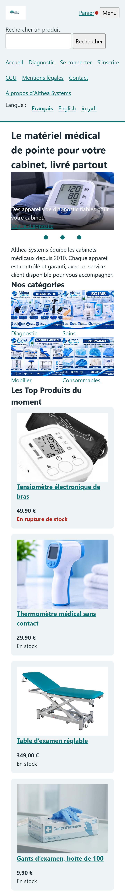
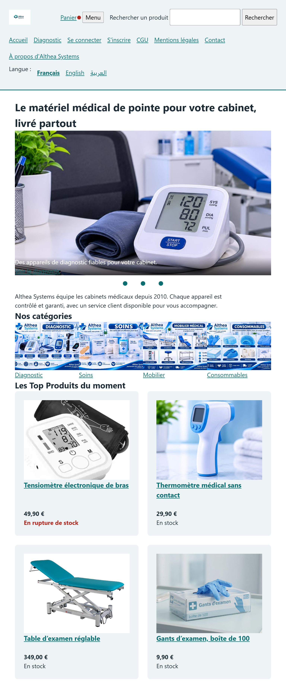
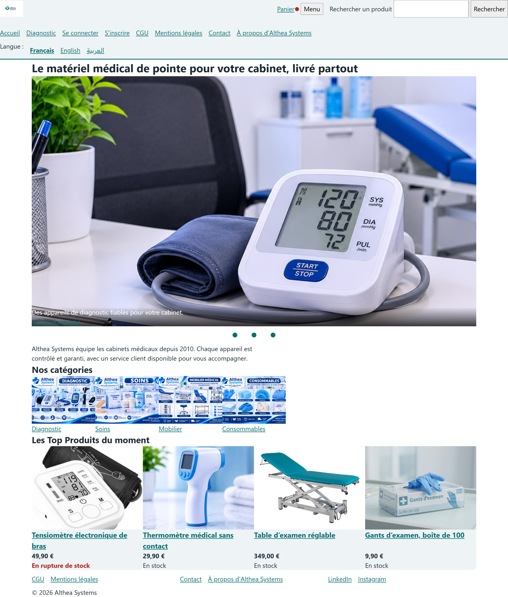
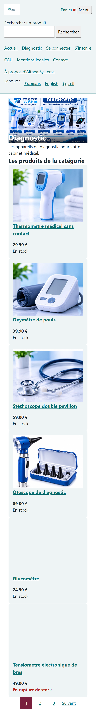
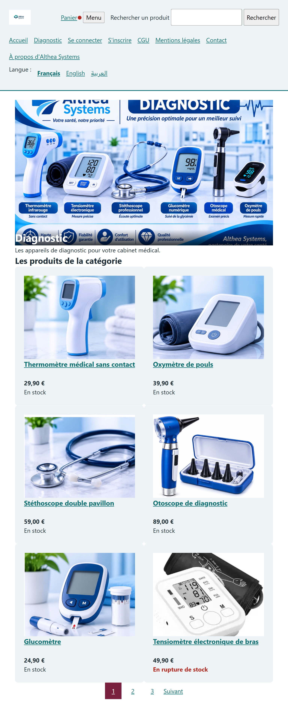
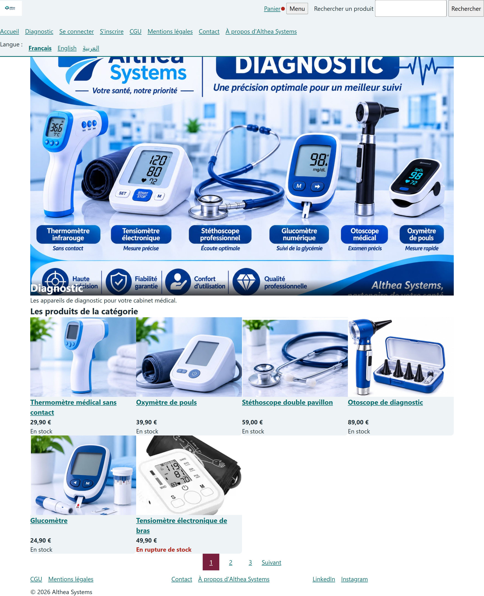
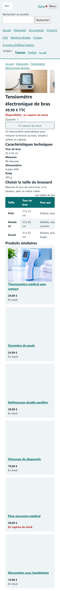
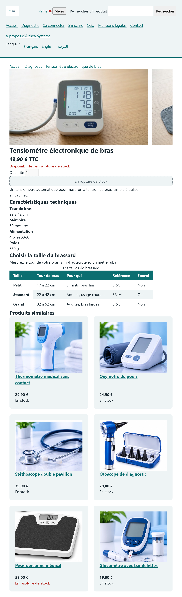
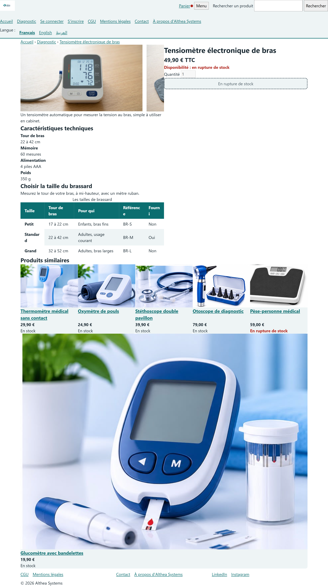
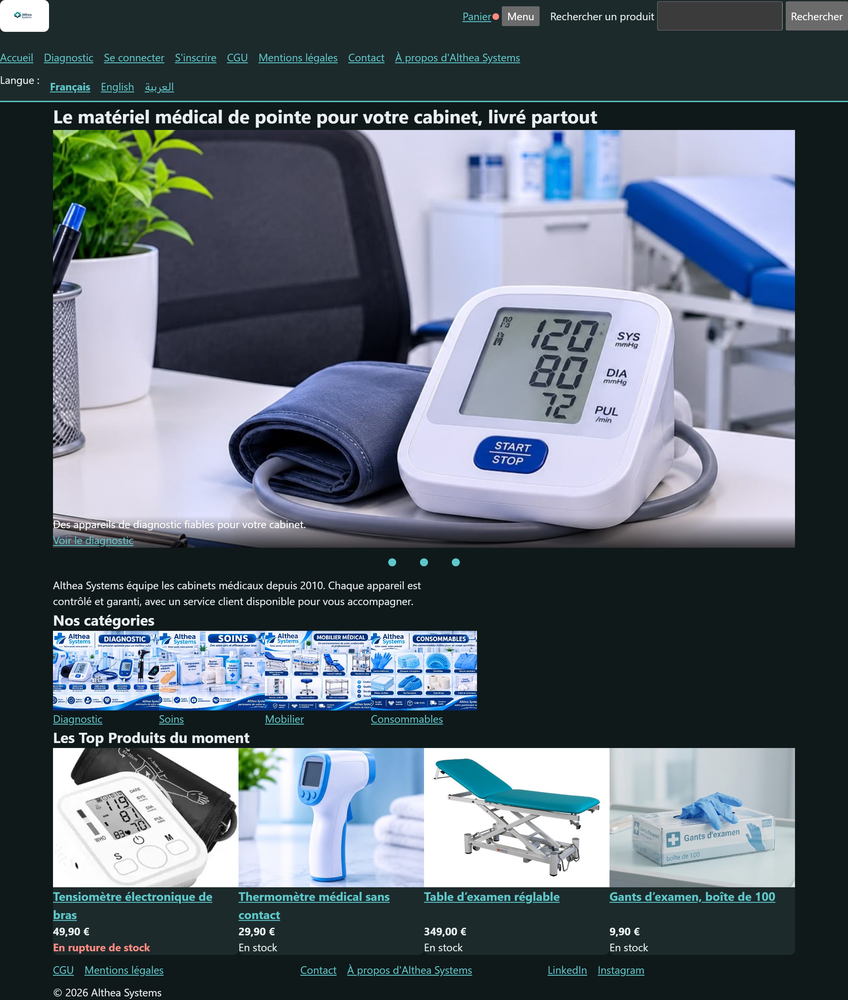

Althea Systems · front
Projet fil rouge (Bachelor CPI Dev, SUP DE VINCI) : le site e-commerce d’Althea Systems, matériel médical pour cabinets. HTML et CSS seuls, sans JavaScrip

## Pages

| Page | Fichier |
|---|---|
| Accueil | index.html |
| Catégorie | categorie.html |
| Produit  | produit.html |
| Recherche | recherche.html |
| Se connecter | connexion.html |
| Créer un compte | inscription.html |
## Responsive

### Les captures

| Page | 360 px | 768 px | 1 280 px |
|---|---|---|---|
| Accueil |  |  |  |
| Catégorie |  |  |  |
| Produit |  |  |  |

Accueil en mode sombre :

### Ce qui cassait, et comment c'est réparé

- Contenu collé aux bords sur ordinateur : conteneur fluide avec `min()` et `margin-inline: auto`.
- Tout empilé sur ordinateur : Flexbox (en-tête, menu, cartes) et Grid (catégories, produits, fiche, recherche).
- Image de la slide trop étroite sur téléphone : `picture` avec une version carrée et une version large.

### Scores Lighthouse

| Page | Accessibilité | Performance |
|---|---|---|
| Accueil | 100 | 93 |
| Catégorie | 100 | 90 |
| Produit | 100 | 100 |

## JavaScript (jour 3)

| Fichier | Rôle |
|---------|------|
| js/main.js | point d'entrée : branche tout le reste |
| js/produits.js | les données : un objet par produit |
| js/tri.js | le tri : prioritaires, autres, épuisés ; tris au choix (liste blanche) |
| js/outils.js | formaterPrix |
| js/catalogue.js | crée les cartes, avec textContent seulement |
| js/panier.js | l'état du panier, sauvegardé et relu avec vérification |
| js/icone-panier.js | le point rouge et le nombre d'articles |
| js/menu.js | menu burger, aria-expanded, Échap |
| js/carrousel.js | boutons et pastille active (IntersectionObserver) |
| js/fiche.js | achat bloqué si épuisé, quantité vérifiée |
| js/avis.js | avis chargés avec fetch, affichés en texte |
| js/recherche.js | recherche sans accent, filtres lus dans l'adresse |
| js/vue-panier.js | page panier |
| js/tests.js | tests, lancés avec ?tests |

**Règle du tri** : prioritaires en tête, autres au milieu, épuisés à la fin, même s'ils sont prioritaires.

**Règle textContent** : une donnée s'écrit comme du texte, jamais avec innerHTML (voir docs/securite.md).