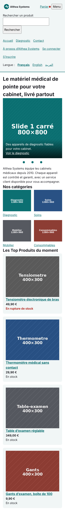
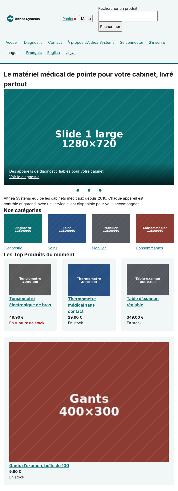
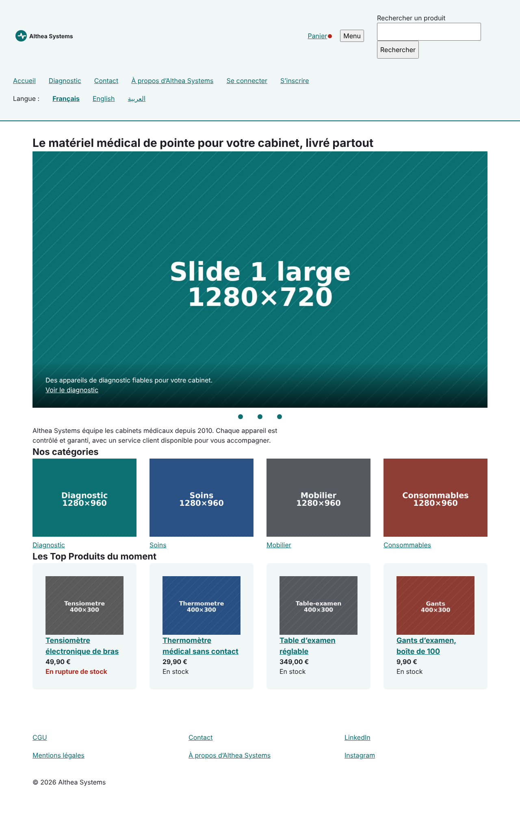
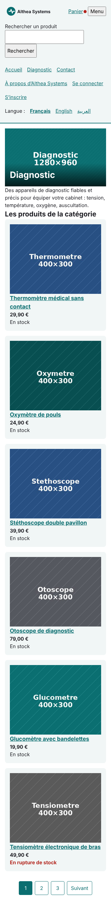
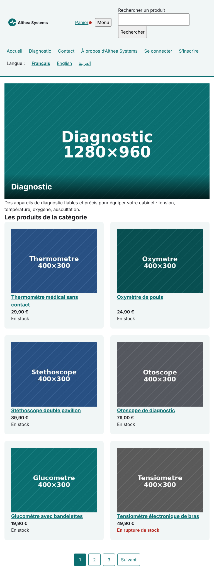
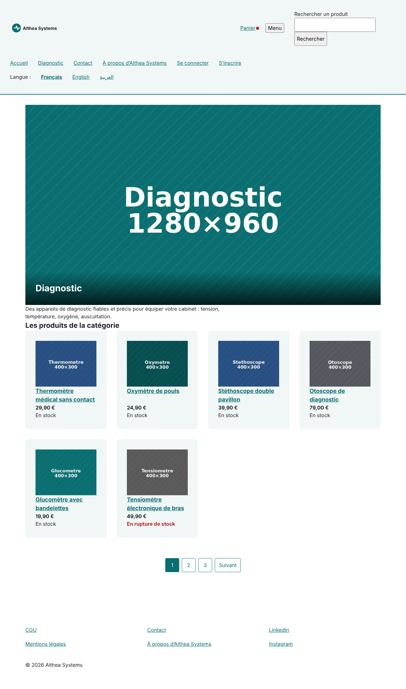
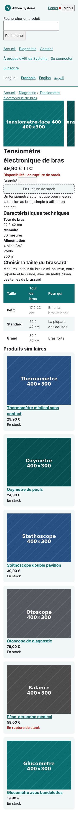
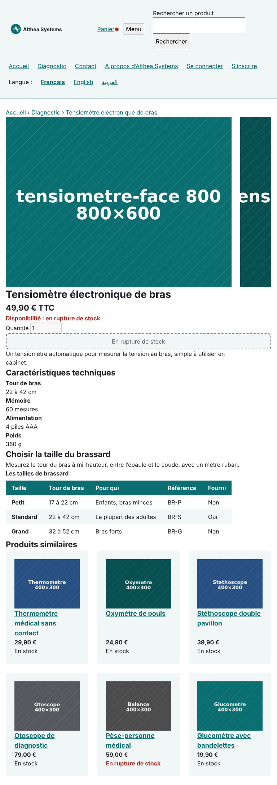
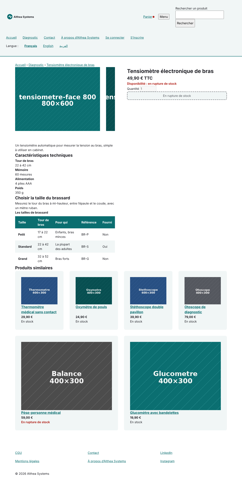
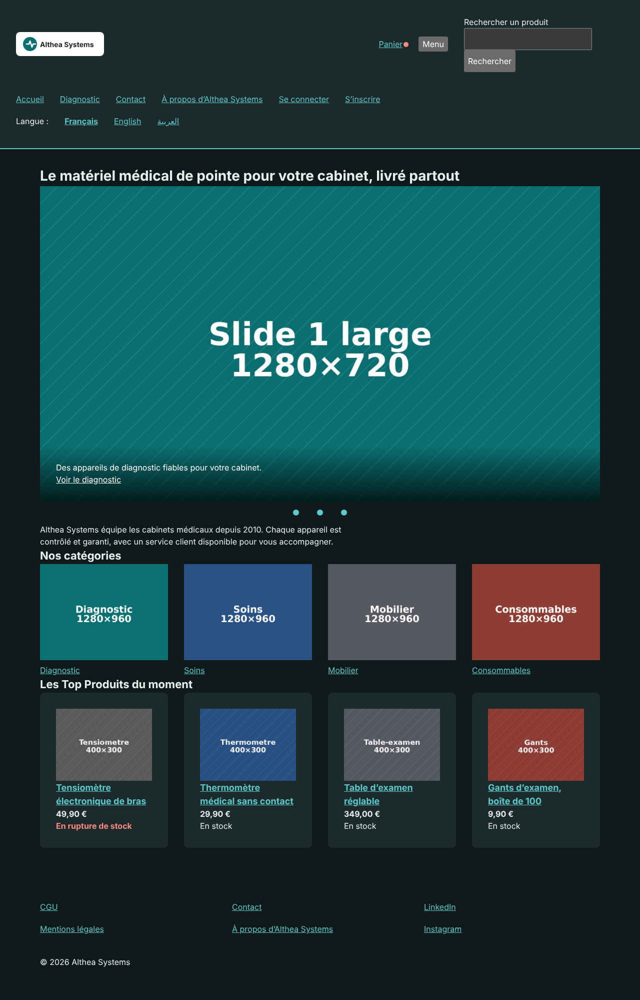

# Althea Systems · front

Projet fil rouge (Bachelor CPI Dev, SUP DE VINCI) : le site e-commerce d’Althea Systems, matériel médical pour cabinets. HTML et CSS seuls, sans JavaScript (jour 2).

## Pages

| Page | Fichier |
|------|---------|
| Accueil | `index.html` |
| Catégorie (Diagnostic) | `categorie.html` |
| Produit (tensiomètre) | `produit.html` |
| Recherche | `recherche.html` |
| Se connecter | `connexion.html` |
| Créer un compte | `inscription.html` |

Styles : `css/variables.css` (charte, mode sombre) et `css/style.css`.

## Responsive (jour 2)

Mobile d’abord : le CSS sans condition est celui du téléphone ; deux paliers en `min-width` (48rem ≈ 768 px, 64rem ≈ 1 024 px). Testé à 320, 360, 768 et 1 280 px, et zoom 200 %.

### Captures

| Page      | 360 px | 768 px | 1 280 px |
|-----------|--------|--------|----------|
| Accueil   |  |  |  |
| Catégorie |  |  |  |
| Produit   |  |  |  |

Mode sombre : 

### Ce qui cassait et comment c’est réparé

| Problème | Correction |
|----------|------------|
| contenu collé aux bords | conteneur fluide `min(100% - 2rem, 70rem)` |
| lignes trop longues sur grand écran | largeur maximum 70rem, centrée |
| en-tête sur plusieurs lignes partout | Flexbox, logo poussé à gauche avec une marge auto |
| liens trop petits pour le doigt | `min-height: 44px` sur les liens |
| image du carrousel trop fine sur téléphone | `picture` : image carrée, puis large à 768 px |
| photos produit trop lourdes | `srcset` + `sizes` : 400 ou 800 px selon l’écran |
| fiche produit en une colonne perdue | `grid-template-areas` en 2 colonnes à partir de 1 024 px |
| tableau qui fait déborder la page | zone `overflow-x: auto`, 1re colonne `sticky` |

Détail des constats : [docs/responsive.md](docs/responsive.md).

### Scores Lighthouse

| Page      | Accessibilité | Performance |
|-----------|---------------|-------------|
| Accueil   | à compléter   | à compléter |
| Catégorie | à compléter   | à compléter |
| Produit   | à compléter   | à compléter |

## Sécurité

CSP sur chaque page, formulaires de compte en `post`, liens externes en `https` avec `noopener`, `.gitignore`. Détail : [docs/securite.md](docs/securite.md).
